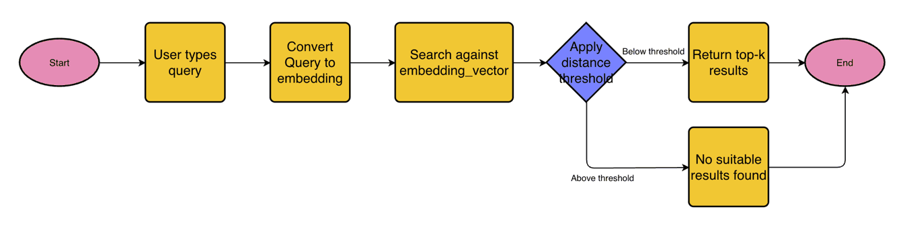

# SkillFindr: semantic search for IBM SkillsBuild

Natural-language course search over the IBM SkillsBuild catalogue, served through a FastAPI service with a retrieval-augmented generation (RAG) endpoint. This is the semantic search component of SkillFindr, a wider IBM-led learning-assistant initiative, built solo as my BSc Computer Science final-year project at Queen Mary University of London (2024/25). Full write-up: [IBM_project_report.pdf](IBM_project_report.pdf).

## What it does

- **Scraper.** Selenium and BeautifulSoup crawl SkillsBuild and collect title, description, duration, tags and ratings for 1,200+ courses.
- **Storage.** One PostgreSQL table holds the structured metadata and, in a pgvector column, a 384-dimensional Sentence-BERT (`all-MiniLM-L6-v2`) embedding of each course's title, description and tags.
- **Search.** A query is embedded with the same model and ranked by cosine distance in pgvector, with a distance threshold and optional filters on duration, rating, learner count and category.
- **API.** `POST /api/v1/courses/search/semantic` returns ranked courses. `POST /api/v1/chat` is a RAG endpoint: it retrieves courses for the latest user message and passes them, with the chat history, to an instruction-tuned LLM (`ibm-granite/granite-3.0-1b-a400m-instruct` in the example config) that writes a recommendation and returns it with the source courses. There is no front-end in this repo, and the chat endpoint was not part of the evaluation.



*Query workflow of the semantic search engine (Figure 3 of the report).*

## Results

Semantic search on 50 hand-written natural-language queries, cut-off K = 20 (Table 5 of the report):

| Metric | Score |
|---|---|
| Recall@20 | 0.899 |
| MRR | 0.843 |
| MAP@20 | 0.712 |
| nDCG@20 | 0.781 |
| Precision@20 | 0.295 |

- Relevance (0, 1 or 2) was labelled by hand only for the courses the retrieval systems returned for each query, 7.2 per query on average. Recall is measured against that judged pool, not the whole catalogue.
- Precision@20 is bounded by the number of relevant courses per query (6.7 on average), which caps it at about 0.34.
- Keyword (PostgreSQL full-text) and BM25 baselines are reported in Chapter 5 of the report. They returned results for only 4% and 6% of these queries, so they are a weak reference rather than a tuned competitor, and the judged pool comes almost entirely from semantic search's own results.

## Running it

Requires Python 3.12, PostgreSQL 15+ with the pgvector extension, and Chrome for the scraper.

```bash
git clone https://github.com/mathisweil/SkillFindr-SemanticSearchEngine.git
cd SkillFindr-SemanticSearchEngine
pip install -r requirements.txt pgvector
```

Create a `.env` in the repo root:

```env
USERNAME=your-skillsbuild-username
PASSWORD=your-skillsbuild-password
LOGIN_URL=https://sb-auth.skillsbuild.org/login
BASE_URL=https://skills.yourlearning.ibm.com
SCRAPE_DELAY=2
EMBEDDING_MODEL_NAME=all-MiniLM-L6-v2
LLM_MODEL_NAME=ibm-granite/granite-3.0-1b-a400m-instruct
DATABASE_URL=postgresql+psycopg2://<user>@localhost:5432/postgres
```

Run each step from the repo root. Raw and processed snapshots are already in `output/`, so the scrape and clean steps are optional.

```bash
python -m scraper.IBM_scraper                    # scrape to output/raw_data
python -m parsers.process_courses                # clean to output/processed_data
python -m database.load_data                     # embed and load into PostgreSQL
python -m evaluation.semantic_search_evaluation  # metrics at K = 20
fastapi dev api/main.py                          # API, Swagger UI at http://127.0.0.1:8000/docs
```

To run the scraper headless, add `"headless": "--headless"` under `webdriver_args` in `config/config.json`.

Example requests once the API is running:

```bash
curl -X POST http://127.0.0.1:8000/api/v1/courses/search/semantic \
  -H "Content-Type: application/json" \
  -d '{"query": "data analysis beginner course", "limit": 5, "filters": {"duration": {"min": 30, "max": 120}, "category": ["data_science"]}}'

curl -X POST http://127.0.0.1:8000/api/v1/chat \
  -H "Content-Type: application/json" \
  -d '{"chat_history": [{"role": "user", "content": "I want to learn web development from scratch"}], "limit": 5}'
```

## Layout

| Path | Contents |
|---|---|
| `scraper/` | Selenium crawler and HTML parsing |
| `parsers/` | Cleaning and normalisation of scraped data |
| `embedding/` | Embedding and retrieval (semantic, keyword, BM25) |
| `database/` | Schema setup, loading, SQL queries and BM25 |
| `models/` | SQLModel course and filter schemas |
| `api/` | FastAPI app |
| `evaluation/` | Annotation tool, query set, relevance labels and metrics |
| `config/` | Scraper settings and cleaning phrase list |
| `utils/` | LLM, Selenium, I/O and text helpers |
| `output/` | Raw and processed scraped data |

## Credits

Supervised by Aisha Abuelmatti at Queen Mary University of London. Thanks to IBM for access to SkillsBuild and for their support; the course data was collected with IBM's approval for academic, non-commercial use.

Mathis Weil, [mathis.weil@outlook.com](mailto:mathis.weil@outlook.com)
